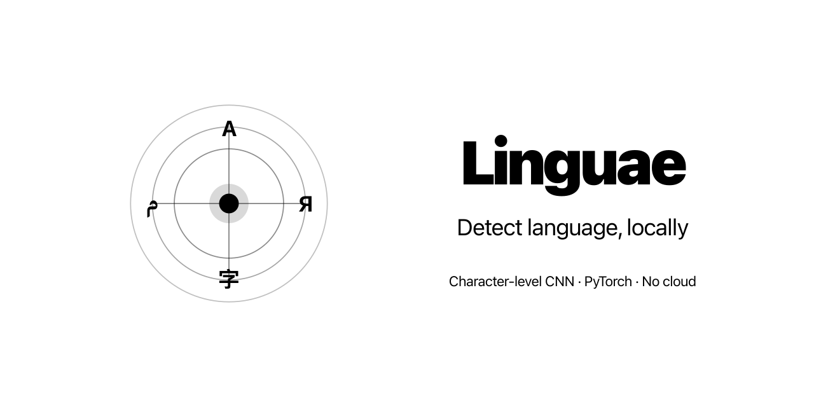
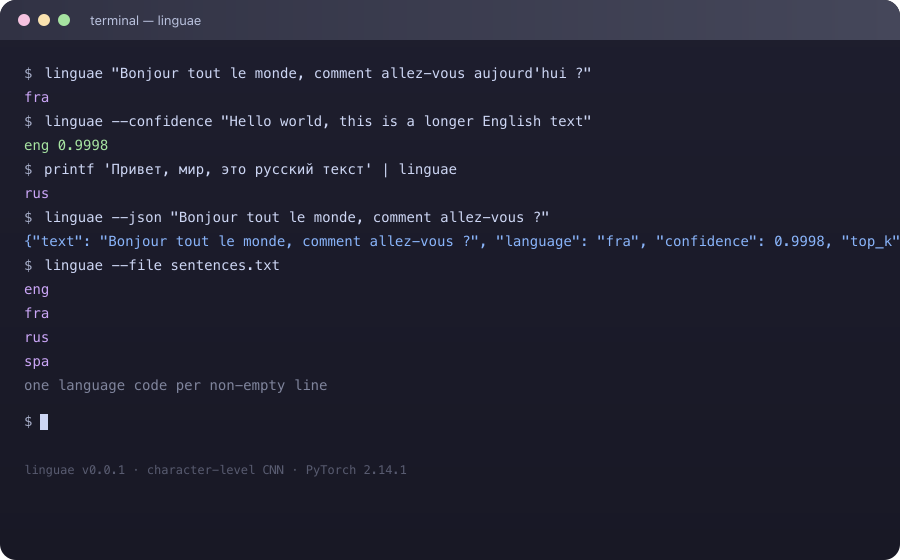

# Linguae

**Detect the language of text with a local character-level model — no cloud, no pretrained weights, no network calls.**

Linguae is a local-first language identification project. It trains a
character-level CNN from scratch in PyTorch on the WiLI-2018 dataset and ships
a standalone command-line tool that predicts exactly one language per input
string. Everything runs on your own machine.

[Documentation](AGENTS.md) · [🚀 Quick Start](#get-started) · [🔍 See It In Action](#see-it-in-action) · [CLI Usage](packages/cli/README.md) · [Model Training](packages/models/README.md)



## The Problem

Language identification still depends on cloud APIs, pretrained weights, or
third-party services — none of which are acceptable for offline, privacy-sensitive,
or air-gapped workflows. Even open-source models often bundle large pretrained
backports that are hard to inspect or shrink.

## The Solution

Linguae trains a small character-level CNN from scratch in PyTorch and exports
a single-file CLI binary built with PyInstaller. The model performs
**single-label classification per string**; it does not detect mixed-language
spans.

- **Local-first & private** — Inference runs entirely on your machine. Your text never leaves your environment.
- **From text to language in one command** — `linguae "Bonjour tout le monde"` prints `fra`.
- **Honest, task-aware model** — One language label per string, with optional confidence scores and top-k alternatives.
- **Reproducible by design** — Fixed random seed, pinned dependency versions, and a deterministic train/val/test split that groups exact duplicate texts within a single split.
- **No pretrained models** — The character-level CNN is trained from scratch on the WiLI-2018 dataset.

## Features

- **Character-level CNN** — Embedding, 1D convolutions (kernel sizes 3, 4, 5), masked max-pooling that ignores padding, and a fully connected classification head.
- **Single-label prediction** — One ISO 639-1 language code per input string.
- **Confidence & top-k** — `--confidence` appends a softmax score; `--json` emits JSON Lines with text, language, confidence, and alternatives.
- **Batch mode** — `--file PATH` classifies each non-empty line of a UTF-8 file.
- **Device selection** — `--device cpu`, `mps`, or `cuda`.
- **Standalone binary** — PyInstaller one-file build distributed via GitHub Releases tagged `latest`.

## See It in Action



Or run the commands directly:

```bash
linguae "Bonjour tout le monde, comment allez-vous aujourd'hui dans ce beau monde"
# fra

linguae --confidence "Hello world, this is a longer English text to test language detection"
# eng	0.9998

printf 'Привет, мир, это более длинный русский текст для проверки определения языка' | linguae
# rus

linguae --json "Bonjour tout le monde, comment allez-vous ?"
# {"text": "Bonjour tout le monde, comment allez-vous ?", "language": "fra", "confidence": 0.9998, ...}
```

## Get Started

### Prerequisites

- [Python](https://www.python.org/) 3.14.8
- [uv](https://github.com/astral-sh/uv)

### Install the CLI

```bash
cd packages/cli
uv sync
```

### Train the model (optional)

```bash
cd packages/models
uv sync
make csv                      # build data/csv/wili-2018.csv from raw txt
# Run notebooks/train_language_detector.ipynb in Jupyter
```

### Run

```bash
cd packages/cli
linguae "Bonjour tout le monde"
```

## HTTP Server and Web App

The `packages/app/server` package exposes the same language detector as a FastAPI HTTP API. The `packages/app` package contains a Next.js web app to interact with it.

### Install and Run

```bash
# Start both with docker-compose
docker-compose up --build

# Or run separately
cd packages/app/server
uv sync
linguae-server

cd packages/app
npm install
npm run dev
```

The server binds to `0.0.0.0:8000` by default. The web app runs on `http://localhost:3000`.
Open <http://127.0.0.1:8000/docs> for the interactive API docs.

### Endpoints

| Method | Path            | Body         | Description                |
| ------ | --------------- | ------------ | -------------------------- |
| GET    | `/health`       | —            | Health check               |
| POST   | `/detect`       | JSON         | Single text detection      |
| POST   | `/detect/form`  | Form-encoded | Single text (form upload)  |
| POST   | `/detect/batch` | JSON         | Batch of texts             |
| POST   | `/detect/file`  | File upload  | Batch from UTF-8 text file |

### Examples

Detect a single language via JSON:

```bash
curl -X POST http://127.0.0.1:8000/detect \
  -H "Content-Type: application/json" \
  -d '{"text":"Bonjour tout le monde, comment allez-vous ?","top_k":3}'
# {"text":"...","language":"fra","confidence":0.99,"top_k":[...]}
```

Detect via form upload:

```bash
curl -X POST http://127.0.0.1:8000/detect/form \
  -d "text=Hello world, this is English" \
  -d "top_k=3"
```

Batch detection via JSON:

```bash
curl -X POST http://127.0.0.1:8000/detect/batch \
  -H "Content-Type: application/json" \
  -d '{"texts":["Bonjour tout le monde","Hello world"],"top_k":2}'
```

Batch detection from an uploaded file:

```bash
curl -X POST http://127.0.0.1:8000/detect/file \
  -F "file=@texts.txt"
```

### Configuration

All settings are overridable via environment variables (see `packages/server/README.md`):

| Variable                      | Default                       | Description                |
| ----------------------------- | ----------------------------- | -------------------------- |
| `LINGUAE_SERVER_HOST`         | `0.0.0.0`                     | Bind host                  |
| `LINGUAE_SERVER_PORT`         | `8000`                        | Bind port                  |
| `LINGUAE_ARTIFACT_DIR`        | `../models/artifacts/linguae` | Artifact directory         |
| `LINGUAE_DEVICE`              | `cpu`                         | Torch device               |
| `LINGUAE_RATE_LIMIT`          | `true`                        | Enable rate limiting       |
| `LINGUAE_RATE_LIMIT_REQUESTS` | `60`                          | Max requests per window    |
| `LINGUAE_RATE_LIMIT_WINDOW`   | `60`                          | Window size in seconds     |
| `LINGUAE_CORS`                | `true`                        | Enable CORS                |
| `LINGUAE_CORS_ORIGINS`        | `*`                           | Comma-separated origins    |
| `LINGUAE_TIMEOUT`             | `30.0`                        | Request timeout in seconds |

### Middlewares

- **Request ID** — `X-Request-ID` header injected and echoed on every response.
- **Rate limiting** — sliding window keyed by client IP (default 60 req/60s).
- **CORS** — configurable origins, methods, and headers.
- **GZip compression** — responses above 500 bytes are compressed.
- **Timeout** — `X-Response-Time-Seconds` header on every response.

## Use Cases

- **Rapid prototyping** — Detect the language of text snippets without setting up a full NLP pipeline.
- **Offline workflows** — Keep sensitive data on-device while classifying text.
- **Teaching & learning** — Explore character-level CNNs, train/val/test splitting, and evaluation end-to-end.
- **Model portability** — Ship a single binary that runs on any Linux machine without Python installed.

## Why This Project?

- **Focused scope** — Does one thing well: predict one language per string from a character-level CNN. No AutoML bloat, no pretrained weights.
- **Transparent** — Clear training pipeline, per-metric explanations, and reproducibility metadata.
- **Local-first** — Runs entirely on your machine; no vendor lock-in or external dependencies.
- **Production-minded demo** — Real PyTorch + Typer + PyInstaller implementation with CI, linting, and GitHub Releases.

## Project Status and Trust

- **Maturity:** Software demonstration (not intended for production safety-critical use).
- **Dataset:** WiLI-2018 (without labels), 235,000 examples across 233 language classes.
- **Architecture:** Character-level CNN trained from scratch in PyTorch, exported as a PyInstaller one-file binary.
- **License:** [MIT License](LICENSE) — see the `LICENSE` file for full terms.
- **Tech stack:** Python 3.14.8, PyTorch 2.14.1, NumPy 2.5.4, pandas 3.1.0, Typer 0.27.3, PyInstaller, uv, ruff.
- **Note on text length:** The model was trained on paragraphs typically 100–1000+ characters long. It performs best on texts of at least ~50–100 characters. Very short texts may produce low-confidence or incorrect predictions.

## Community and Contributions

Contributions, bug reports, and feature suggestions are welcome. See:

- [AGENTS.md](AGENTS.md) — architecture, pipeline, dependencies, build/test commands
- [packages/cli/AGENTS.md](packages/cli/AGENTS.md) — CLI internals and artifact resolution
- [packages/models/AGENTS.md](packages/models/AGENTS.md) — training pipeline and data

To report issues or propose changes, open an issue or pull request in this repository.

## Call to Action

**[Get Started](#get-started)** — Run `linguae` locally in seconds and classify your first string.

## License

This project is licensed under the [MIT License](LICENSE).
