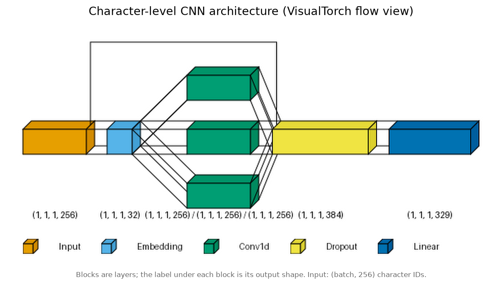
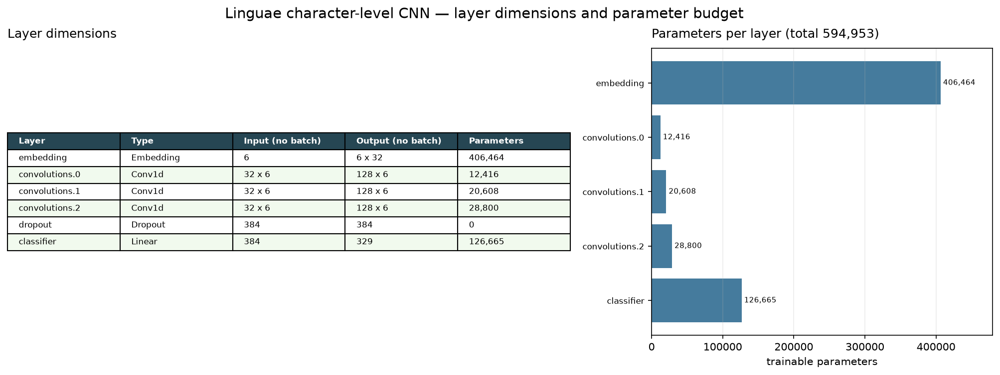
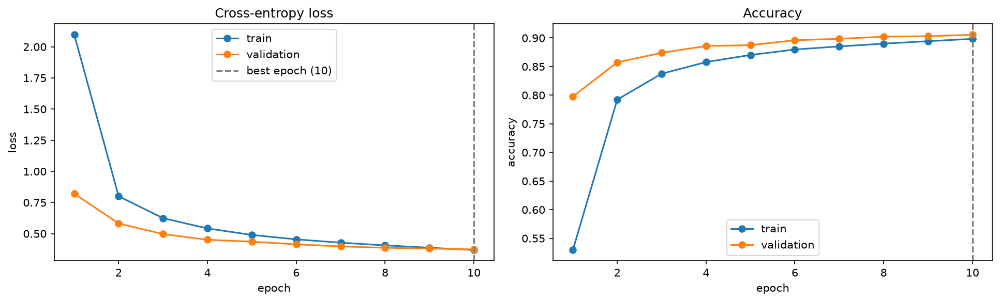
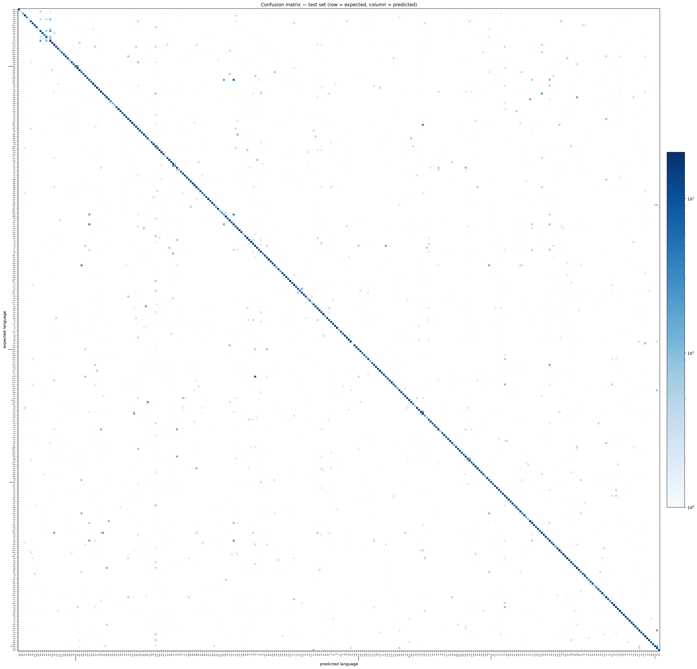
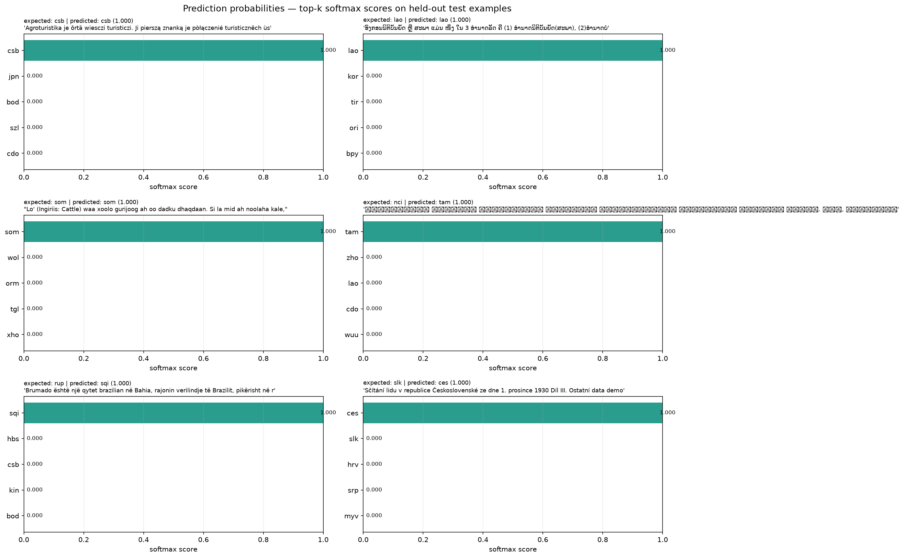
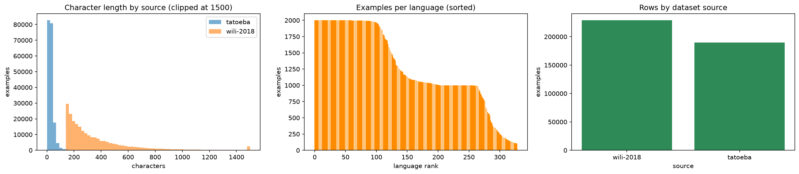
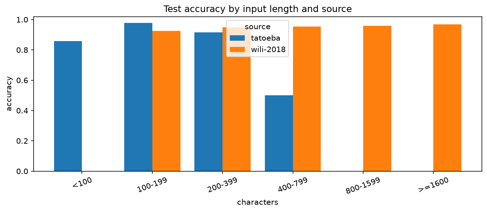

# Linguae Models

Training pipeline and data for the Linguae character-level language detector.

Training uses two complementary sources:

- **Tatoeba** (`data/csv/tatoeba.tsv`) — short conversational sentences.
- **WiLI-2018** (`data/csv/wili-2018.csv`) — long sentences and Wikipedia
  paragraphs.

Both sources share one label space, so the exported model handles short phrases
and paragraph-length text with the same artifact.

## Structure

```
packages/models/
├── notebooks/              # Exploratory Jupyter notebooks
│   │   ├── train_language_detector.ipynb
│   │   └── wili_2018_txt_to_csv.ipynb
│   └── scripts/                # Headless training and data-conversion scripts
│       ├── train_language_detector.py
│       ├── wili_2018_txt_to_csv.py
│       └── tatoeba_tsv_to_csv.py
├── data/
│   ├── csv/
│   │   ├── languages.csv       # WiLI label → name + family lookup
│   │   ├── tatoeba.tsv         # Short sentences (id, language, text)
│   │   └── wili-2018.csv       # Long text (text, language)
│   ├── processed/
│   │   └── labels.json         # Label → index mapping
│   └── txt/wili-2018/          # Raw WiLI-2018 data
├── artifacts/
│   ├── images/                 # Training visualisations
│   │   ├── network_architecture.png
│   │   ├── layer_dimensions.png
│   │   ├── training_curves.png
│   │   ├── confusion_matrix.png
│   │   ├── prediction_probabilities.png
│   │   ├── dataset_quality.png
│   │   └── accuracy_by_length.png
│   └── linguae/                # Exported CLI artifact
├── pyproject.toml
└── Makefile
```

## Getting started

```bash
uv sync
make csv                      # build data/csv/wili-2018.csv from raw txt
make train                    # run notebooks/train_language_detector.py
```

`make notebook` is an alias for `make csv`. `make train-notebook` executes the
Jupyter version of the training notebook instead.

## Data

### Tatoeba (`data/csv/tatoeba.tsv`)

Headerless, tab-separated, with three columns:

| Column     | Description             |
| ---------- | ----------------------- |
| `id`       | Tatoeba sentence id     |
| `language` | ISO 639-3 language code |
| `text`     | Sentence text           |

Only `language` and `text` are used. Rows with missing (`\N`) labels are
discarded. Tatoeba supplies the **short** sentences.

### WiLI-2018 (`data/csv/wili-2018.csv`)

Comma-separated with a header and two columns, `text,language`. It is generated
from the raw files in `data/txt/wili-2018/`:

- `x_train.txt`, `y_train.txt` (117,500 examples)
- `x_test.txt`, `y_test.txt` (117,500 examples)
- `labels.csv` maps ISO 639-3 codes to language names and families.

WiLI-2018 supplies the **long** sentences and paragraphs. `data/csv/languages.csv`
is its label/name/family lookup.

### Combining the sources

The trainer normalises both sources, then:

1. Merges known Tatoeba/WiLI label variants (for example `cmn` → `zho`,
   `swh`/`swc` → `swa`) so a language is not split across classes.
2. Drops texts that carry contradictory labels.
3. Deduplicates `(text, language)` pairs, including texts shared by both
   sources.
4. Subsamples each source per language (1000 rows by default) so WiLI and
   Tatoeba contribute comparable volume.
5. Drops labels with fewer than 100 examples by default.

Texts are truncated to `max_length=256` characters. WiLI paragraphs are longer
than that (median ~271 characters), so long inputs are classified from their
first 256 characters.

## Training pipeline

`notebooks/train_language_detector.py` performs:

1. **Data validation**: per-source schema checks, missing labels, duplicates,
   conflicting labels, per-language counts, and character-length distributions.
2. **Splitting**: deterministic 80/10/10 train/val/test split with exact
   duplicate texts grouped within a single split.
3. **Vocabulary**: character vocabulary built from the training split only,
   with `<pad>` (0) and `<unk>` (1) special tokens.
4. **Model**: character-level CNN with embedding, 1D convolutions (kernel sizes
   3, 5, 7), masked max-pooling, and a fully connected head.
5. **Training**: AdamW, cross-entropy on logits, early stopping on validation
   loss, best checkpoint restoration.
6. **Evaluation**: overall and per-source accuracy, per-class
   precision/recall/F1, macro-F1, confusion matrix, length-stratified accuracy,
   and misclassified examples.
7. **Visualisation**: VisualTorch renders the network architecture; Matplotlib
   renders layer dimensions, training curves, the confusion matrix and
   prediction probabilities in `artifacts/images/`.
8. **Export**: a versioned, self-contained artifact with checksums.

## Environment overrides

All optional:

| Variable                                   | Default                  | Purpose                                     |
| ------------------------------------------ | ------------------------ | ------------------------------------------- |
| `LINGUAE_WILI_CSV`                         | `data/csv/wili-2018.csv` | Long-form CSV path                          |
| `LINGUAE_TATOEBA_TSV`                      | `data/csv/tatoeba.tsv`   | Short-form TSV path                         |
| `LINGUAE_DISABLE_WILI`                     | `0`                      | `1` skips the WiLI source                   |
| `LINGUAE_DISABLE_TATOEBA`                  | `0`                      | `1` skips the Tatoeba source                |
| `LINGUAE_DATASET_PATH`                     | unset                    | Single custom CSV instead of both defaults  |
| `LINGUAE_MIN_EXAMPLES_PER_LANGUAGE`        | `100`                    | Drop labels below this many rows            |
| `LINGUAE_MAX_ROWS_PER_LANGUAGE_PER_SOURCE` | `1000`                   | Per-source cap; `0` keeps all rows          |
| `LINGUAE_MAX_ROWS_PER_LANGUAGE`            | `0`                      | Cap on the combined frame; `0` keeps all    |
| `LINGUAE_MAX_LENGTH`                       | `256`                    | Character sequence length                   |
| `LINGUAE_BATCH_SIZE`                       | `256`                    | Batch size                                  |
| `LINGUAE_EPOCHS`                           | `10`                     | Maximum epochs                              |
| `LINGUAE_PROCESSED_DIR`                    | `data/processed`         | `labels.json` output directory              |
| `LINGUAE_PLOTS_DIR`                        | `artifacts/images`       | Image output directory                      |
| `LINGUAE_ARTIFACT_DIR`                     | `artifacts/linguae`      | Export directory                            |
| `LINGUAE_ALLOW_OVERWRITE`                  | `0`                      | `1` replaces a non-empty artifact directory |
| `LINGUAE_LOG_LEVEL`                        | `INFO`                   | Logging verbosity                           |
| `LINGUAE_PROGRESS_EVERY`                   | `200`                    | Log every N batches                         |

Setting `LINGUAE_DATASET_PATH` restores the old single-file behaviour; the
custom file is read as a CSV with `text,language` columns.

## Outputs

- `data/processed/labels.json` — label index map
- `artifacts/images/` — training visualisations (Matplotlib and VisualTorch):
  - `network_architecture.png` — VisualTorch flow view of the CNN
  - `layer_dimensions.png` — per-layer input/output shapes and parameter counts
  - `training_curves.png` — loss and accuracy curves
  - `confusion_matrix.png` — confusion matrix heatmap
  - `prediction_probabilities.png` — top-k softmax scores for sample inputs
  - `dataset_quality.png` — per-source length and class balance
  - `accuracy_by_length.png` — accuracy by text length
- `artifacts/linguae/` — CLI artifact:
  - `config.json`, `vocabulary.json`, `labels.json`, `model.pt`
  - `metrics.json` (overall, per-source, per-language, length buckets)
  - `manifest.json` (dataset checksums and training metadata)
  - `linguae_inference.py`, `example_inference.py`
  - `confusion_matrix.csv`, `misclassified_examples.csv`, `training_history.csv`

`make train` and `make train-notebook` set `LINGUAE_ALLOW_OVERWRITE=1` so
retraining replaces an existing artifact. Run the script directly (or pass
`LINGUAE_ALLOW_OVERWRITE=0` to `make`) to keep the non-empty-directory guard.

## Training Visualisations

All training plots are written to `artifacts/images/`:














